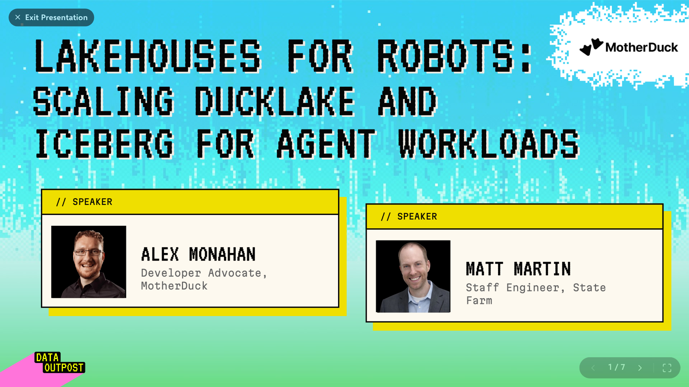

[](https://motherduck.com/dive-gallery/dives/lakehouses-for-robots-scaling-ducklake-and-iceberg-for-agent-workloads)

*The workshop slides, as a Dive in the MotherDuck Dive gallery. Click the image to open them.*

# Data Outpost: lakehouses for robots

Workshop materials for *Lakehouses for Robots: Scaling DuckLake and Iceberg for Agent
Workloads*. By the end, your AI agent queries lakehouses (Apache Iceberg and DuckLake), first
on your laptop with DuckDB and the open source DuckDB MCP server, then on MotherDuck.

Section 1 is all on this page. Every other section has a short summary here and a detailed
guide in its own folder. Run every command from this folder
(`labs/projects/data-outpost-lakehouses`).

Need model tokens? The workshop offers $5 of Luna or Haiku credits on OpenRouter:
<https://motherduck.com/minter/>.

| # | Section | Guide |
|---|---|---|
| 1 | Get uv, Python, & DuckDB installed | [below](#1-get-uv-python--duckdb-installed) |
| 2 | Get the local DuckDB open source MCP set up | [02-local-mcp](02-local-mcp/README.md) |
| 3 | Introduce Iceberg | [03-iceberg](03-iceberg/README.md) |
| 4 | Introduce DuckLake | [04-ducklake](04-ducklake/README.md) |
| 5 | Use MotherDuck with motherduck.com/try | [05-motherduck-try](05-motherduck-try/README.md) |
| 6 | Claim the MotherDuck organization | [06-claim-org](06-claim-org/README.md) |
| 7 | Set up the MotherDuck Remote MCP | [07-remote-mcp](07-remote-mcp/README.md) |
| 8 | End to end agent example on MotherDuck | [08-end-to-end](08-end-to-end/README.md) |
| 9 | Best practices for local development with agents | [09-local-dev-best-practices](09-local-dev-best-practices/README.md) |
| 10 | Bonus round: DuckDB 2.0's Async IO and Lakehouses | [10-bonus-async-io](10-bonus-async-io/README.md) |

---

## 1. Get uv, Python, & DuckDB installed

Do this before the workshop. It downloads extensions, data and the MCP server, which is slow
on conference Wi-Fi.

**Why uv?** The MCP server is a Python package. uv fetches Python if you don't have it, and
`uvx` runs the server from a cached, isolated environment with pinned versions. You never
touch your system Python, and the same commands work on macOS, Linux and Windows. Everything
pins Python 3.13 because DuckDB 1.5.6 has no prebuilt package for newer Pythons, and without
one uv tries to compile DuckDB from source.

### Install uv

macOS / Linux:

```bash
curl -LsSf https://astral.sh/uv/install.sh | sh
```

Windows (PowerShell):

```powershell
powershell -ExecutionPolicy ByPass -c "irm https://astral.sh/uv/install.ps1 | iex"
```

Or, anywhere you already have Python:

```bash
pip install uv
```

Then open a new terminal so `uv` and `uvx` are on your `PATH`.

### Get the workshop repo and install everything

Workshop repo: <https://github.com/motherduckdb/labs/tree/main/projects/data-outpost-lakehouses>

The same commands work in a macOS/Linux terminal and in Windows PowerShell:

```bash
git clone https://github.com/motherduckdb/labs.git   # or download the repo ZIP from GitHub
cd labs/projects/data-outpost-lakehouses           # run every command in this guide from here

# 1. Install Python 3.13 (uv manages it; your system Python is untouched)
uv python install 3.13

# 2. Install the DuckDB CLI 1.5.6
uv tool install --force duckdb-cli==1.5.6

# 3. Install DuckDB 1.5.6 for Python, in a .venv in this folder
uv venv --python 3.13
uv pip install --python .venv duckdb==1.5.6
uv run --python .venv python -c "import duckdb; print(duckdb.__version__)"   # 1.5.6

# 4. Build the workshop database (~15 s on a fast connection, ~125 MB; also downloads the iceberg and httpfs extensions)
uvx --from duckdb-cli==1.5.6 duckdb data/workshop.duckdb -f mcp/build_workshop_db.sql

# 5. Pre-download the MCP server so its first start doesn't time out
uvx --python 3.13 --with duckdb==1.5.6 mcp-server-motherduck@1.1.0 --help
```

Notes:

- `--force` in step 2 replaces any `duckdb` already installed in uv's tool folder
  (`~/.local/bin` on macOS/Linux). `duckdb --version` should print `v1.5.6`. The guides run
  the CLI as `uvx --from duckdb-cli==1.5.6 duckdb`, which uses 1.5.6 whatever `duckdb` is on
  your `PATH`.
- `uv pip install --python .venv` installs into this folder's `.venv` even if another
  environment is active.
- Step 4 writes `data/workshop.duckdb` with two tables: `personas`, a local copy of all
  1,000,000 rows (9 of 22 columns) of the public Iceberg table `nvidia.personas_brazil` on
  Hugging Face, and `states`, a 27-row lookup of each state's abbreviation and region.
  Sections 2, 3 and 9 use it. If step 4 hangs, the catalog Space is asleep: run
  `curl -s https://kszucs-catalog.hf.space/v1/config` and retry. Rerunning step 4 replaces
  both tables but keeps any other table in the file; to start clean (for example if you built
  an older version with `lineitem` and `store`), delete `data/workshop.duckdb` first.

Next: [2. Get the local DuckDB open source MCP set up](02-local-mcp/README.md).

---

## 2. Get the local DuckDB open source MCP set up

Connect your agent to DuckDB on your laptop with the open source
[`mcp-server-motherduck`](https://github.com/motherduckdb/mcp-server-motherduck) (1.1.0,
running DuckDB 1.5.6 through `uvx`). Paste the prompt below and let the agent set the
server up itself, or configure your client by hand. The guide has the manual setup for Claude
Code, Codex CLI, GitHub Copilot, Cursor, Claude Desktop, the ChatGPT desktop app and OpenCode.

- Query a few example files, create a dataset locally and poke around a bit

Paste this prompt into your agent:

```text
Set up this MCP server (https://github.com/motherduckdb/mcp-server-motherduck) locally in Dev
Mode as mentioned in the README, with DuckDB pinned to 1.5.6 (run it with
uvx --python 3.13 --with duckdb==1.5.6), and connect it to this agent session.
Refer also to the workshop repo here:
(https://github.com/motherduckdb/labs/tree/main/projects/data-outpost-lakehouses) Do this as
automatically as possible, but if you fail to set it all the way up, give me short clear
instructions to configure it.
```

Guide: [02-local-mcp/README.md](02-local-mcp/README.md)

## 3. Introduce Iceberg

Apache Iceberg is an open table format: Parquet data files in object storage plus a metadata
tree that tracks snapshots, schema and partitions. DuckDB reads Iceberg tables with the
`iceberg` extension. [Faceberg](https://github.com/huggingface/faceberg) serves Hugging Face
datasets as Iceberg tables through public REST catalogs, which DuckDB attaches with no
credentials:

```sql
INSTALL iceberg; LOAD iceberg; INSTALL httpfs; LOAD httpfs;
ATTACH 'https://kszucs-catalog.hf.space' AS hf (
    TYPE iceberg,
    ENDPOINT 'https://kszucs-catalog.hf.space',
    AUTHORIZATION_TYPE 'none'
);
SELECT state, count(*) AS personas, round(avg(age), 1) AS avg_age
FROM hf.nvidia.personas_brazil
GROUP BY ALL ORDER BY personas DESC LIMIT 5;
```

The main dataset is `nvidia.personas_brazil`, 1,000,000 synthetic Brazilian personas. The
same Iceberg table runs on MotherDuck in sections 3 and 8.

- Query public Iceberg tables on Hugging Face with DuckDB and the open source MCP

Guide: [03-iceberg/README.md](03-iceberg/README.md)

## 4. Introduce DuckLake

DuckLake is an open lakehouse format that keeps the catalog in a SQL database and the data in
Parquet files. A frozen DuckLake is a read-only DuckLake whose whole catalog is one
`.ducklake` file, so nothing runs except storage. You build one over public Hacker News
Parquet files without copying any data.

- Query a frozen DuckLake with DuckDB and the open source MCP

Guide: [04-ducklake/README.md](04-ducklake/README.md)

## 5. Use MotherDuck with [motherduck.com/try](http://motherduck.com/try)

[motherduck.com/try](https://motherduck.com/try) gives you a limited AI chat over a free,
temporary MotherDuck organization, with no login. Pick a sample dataset or paste a public
Parquet or CSV URL, and see the same kinds of queries running in the cloud.

Guide: [05-motherduck-try/README.md](05-motherduck-try/README.md)

## 6. Claim the MotherDuck organization

A temporary organization is deleted unless a person claims it by signing up or signing in.
Claiming makes you the owner of its databases. A claimed organization stays separate from any
organization you already have.

Guide: [06-claim-org/README.md](06-claim-org/README.md)

## 7. Set up the MotherDuck Remote MCP

MotherDuck hosts a remote MCP server at `https://api.motherduck.com/mcp`. Most clients
connect over HTTP and sign in with OAuth, so there is nothing to install locally. It adds
read-write SQL on MotherDuck plus tools for Dives and Flights.

Guide: [07-remote-mcp/README.md](07-remote-mcp/README.md)

## 8. End to end agent example on MotherDuck

Drive a small pipeline on MotherDuck from your agent: attach the same `nvidia.personas_brazil`
Iceberg table with `CREATE DATABASE ... (TYPE ICEBERG)`, load it into DuckLake (rerun by a
Flight, a scheduled Python job on MotherDuck), transform it with SQL, and visualize the result
with a Dive (an interactive visualization saved in MotherDuck).

Guide: [08-end-to-end/README.md](08-end-to-end/README.md)

## 9. Best practices for local development with agents

Agents fire many small queries. Answering them locally, from tables and catalogs on your
laptop, makes them faster and cheaper than going back to object storage or the cloud each
time. These patterns go from simplest to most complete.

1. Local caching (create local tables)
2. Local catalog for fast quick lookups
3. Local catalog and files
4. Local catalog and files and syncing with the data change feed

Guide: [09-local-dev-best-practices/README.md](09-local-dev-best-practices/README.md)

## 10. Bonus round: DuckDB 2.0's Async IO and Lakehouses

DuckDB 2.0 adds asynchronous I/O: a separate thread pool keeps many reads in flight while
worker threads decode data that has already arrived. Remote Parquet scans, including Parquet
read through DuckLake, can get much faster. The workshop pins 1.5.6, so try 2.0 in a separate
environment.

Guide: [10-bonus-async-io/README.md](10-bonus-async-io/README.md)

---

## Troubleshooting

| Symptom | Fix |
|---|---|
| `uv` or `uvx` not found | Open a new terminal, or run `uv tool update-shell`. |
| `spawn uvx ENOENT` in a desktop app | Use the full `uvx` path from `print_configs.py` as `command`. |
| Server times out on first start | Run step 5 of [section 1](#1-get-uv-python--duckdb-installed). In Codex, add `startup_timeout_sec = 30` under `[mcp_servers.duckdb]` in `~/.codex/config.toml`. |
| `Could not set lock on file ...workshop.duckdb` | Close the read-write `duckdb` session that has the file open. When rebuilding it (step 4), also stop the MCP server, which holds it open read-only. |
| Step 4 or an `hf` query hangs, or fails with `HTTP 429` | The catalog Space is asleep: `curl -s https://kszucs-catalog.hf.space/v1/config`, then retry. `429` means the room used up the Hugging Face rate limit; wait 5 minutes (see [section 3](03-iceberg/README.md#caveats)). |
| Copilot CLI: `Classic Personal Access Tokens (ghp_) are not supported` | `unset GH_TOKEN` (PowerShell: `Remove-Item Env:GH_TOKEN`) |
| Claude Desktop doesn't show duckdb | Check `mcp-server-duckdb.log` in `~/Library/Logs/Claude/` (macOS) or `%APPDATA%\Claude\logs\` (Windows). |

## Files

Numbered folders hold the guide for each section. The scripts and data live where they always
have, so existing commands keep working.

| File | What it does |
|---|---|
| `mcp/build_workshop_db.sql` | Builds `data/workshop.duckdb` (`personas`, `states`) from the public Iceberg table `nvidia.personas_brazil` on Hugging Face (section 1) |
| `mcp/init.sql` | Loads the iceberg and httpfs extensions on every server connection |
| `mcp/print_configs.py` | Prints each client's config with your absolute paths (section 2) |
| `public_iceberg_datasets.sql` | Attaches public Hugging Face Iceberg catalogs and queries them (section 3) (`uvx --from duckdb-cli==1.5.6 duckdb -f public_iceberg_datasets.sql`) |
| `frozen/build_frozen_ducklake.sql` | Builds `data/hacker_news.ducklake`, a frozen DuckLake over public Parquet files (section 4) |
| `10-bonus-async-io/compare_async_io.py` | Times a remote Parquet scan on DuckDB 1.5.6 vs 2.0.0 (section 10) |
| `02-local-mcp/` … `10-bonus-async-io/` | The detailed guide for each section |
| `images/dive-gallery.png` | Title slide screenshot from the Dive gallery, used at the top of this page |
